# Overview

This project develops a reproducible framework for incorporating **outdoor thermal conditions directly into walking impedance and accessibility analysis**.

The central methodological idea is:

> Conventional accessibility models usually treat environmental conditions as external context. Here, heat stress modifies the generalized cost of walking through the street network.

The Toronto proof-of-concept extends this idea from a single thermal surface to a **multi-scenario workflow** in which urban form, meteorology, thermal stress, network impedance, accessibility, and observed mobility response are linked sequentially.

## Conceptual chain

**Urban form + meteorology → spatial UTCI → thermal network impedance → heat-conditioned accessibility → observed mobility response**

The Toronto workflow includes:

- an 8 × 8 km walking-network study domain centered on the University of Toronto;
- a 2 × 2 km U of T pilot domain for detailed thermal modelling;
- Toronto 3D Massing building heights;
- terrain, building, and canopy inputs;
- SOLWEIG thermal modelling;
- 14 hot and matched-reference thermal scenarios;
- scenario-specific UTCI rasters;
- scenario-specific thermal edge costs;
- accessibility from 50 origins to transit destinations;
- comparison with Bike Share Toronto activity;
- robustness analysis across 75 stations and a predefined 50-station core;
- sensitivity to thermal threshold and $\lambda$.

# 1. Study area and spatial context

The Toronto case study is centered on the **University of Toronto St. George campus**.

Two spatial extents are used:

1. an approximately **8 × 8 km study domain** for the broader walking network;
2. a **2 × 2 km pilot domain** for detailed urban-form and thermal modelling.

The walking-network topology is held fixed across thermal scenarios. This allows changes in accessibility to be attributed to changing **thermal impedance**, rather than changes in the network itself.

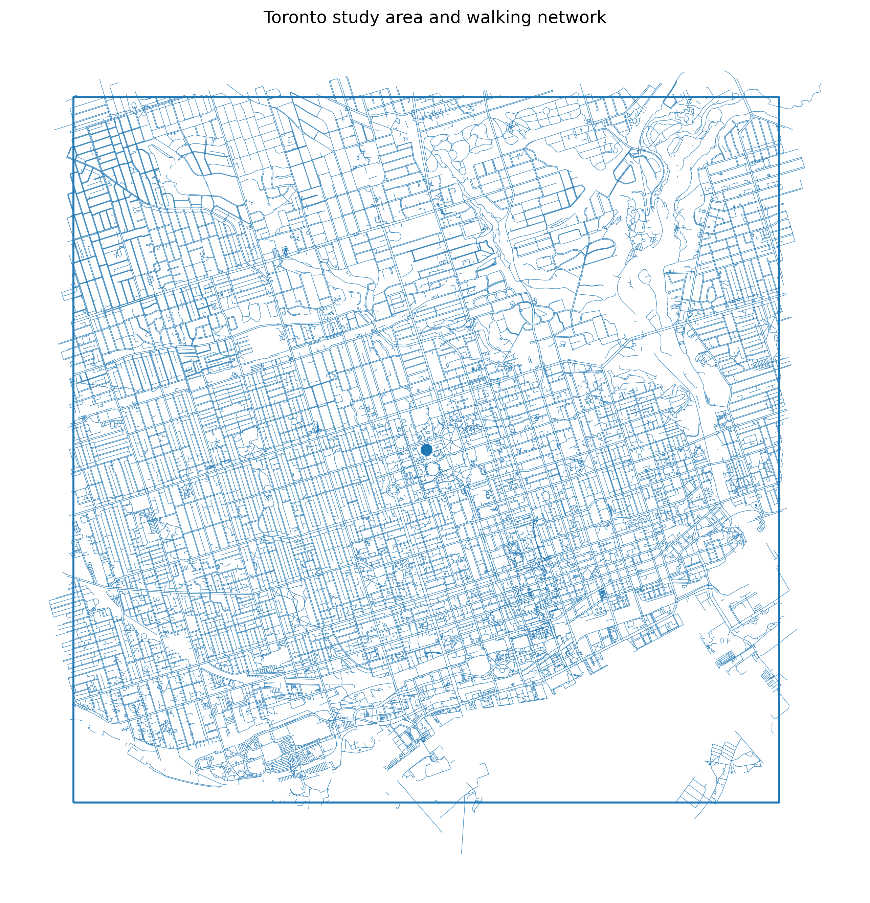{#fig-study-area width=85%}

# 2. Urban form and thermal-model inputs

The thermal model represents the physical structure of the urban environment using:

- building geometry;
- building height;
- vegetation and canopy;
- terrain elevation;
- Digital Elevation Model (DEM);
- Digital Surface Model (DSM);
- Canopy Digital Surface Model (CDSM).

These layers are aligned to a common raster grid before thermal simulation.

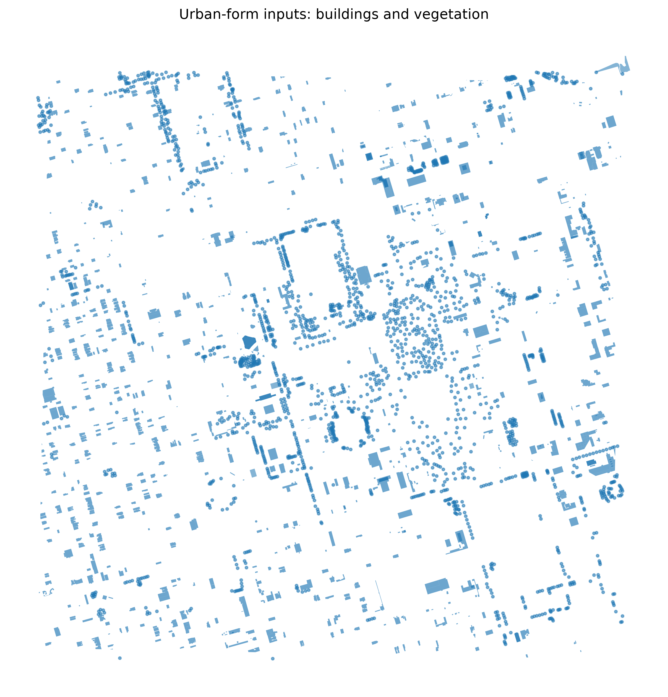{#fig-urban-form width=80%}

## DEM, DSM, and CDSM

The **DEM** represents ground elevation.

The **DSM** represents terrain plus above-ground built structures.

The **CDSM** represents canopy height.

Together, these surfaces define the physical geometry used by SOLWEIG.

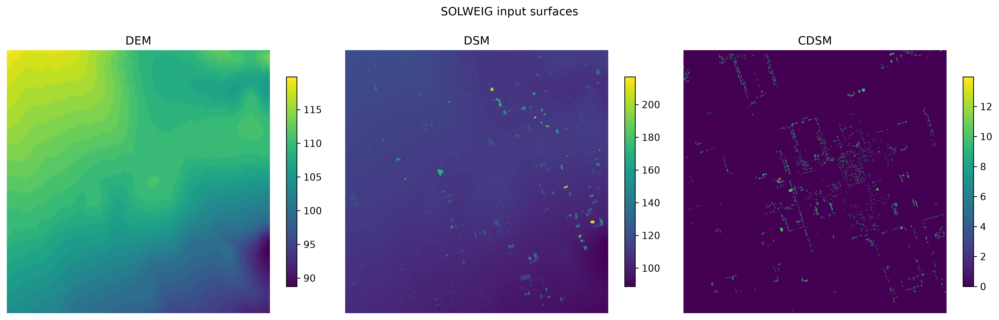{#fig-solweig-inputs width=95%}

# 3. Thermal scenarios

A **thermal scenario** represents one selected summer meteorological condition evaluated at the common analysis time of **15:00 local time**.

Each scenario contains:

- air temperature;
- relative humidity;
- wind speed;
- shortwave radiation.

Urban form is held fixed.

This design allows the analysis to compare how the **same city morphology** behaves under different thermal conditions.

## Scenario types

### Hot scenario

A selected high-temperature summer condition representing stronger thermal stress.

### Reference scenario

A moderate comparison condition paired with a hot scenario.

### Anchor scenario

The **25 July 2025** event is retained as an anchor connecting the original one-day proof-of-concept to the multi-scenario analysis.

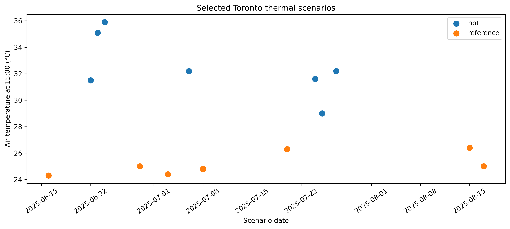{#fig-scenarios width=90%}

# 4. From meteorology to spatial thermal stress

SOLWEIG is used to transform the fixed urban environment and scenario-specific meteorology into spatially explicit thermal fields.

The principal thermal indicator used in the network analysis is **UTCI — Universal Thermal Climate Index**.

UTCI represents outdoor thermal stress in a form that integrates multiple meteorological and radiant influences.

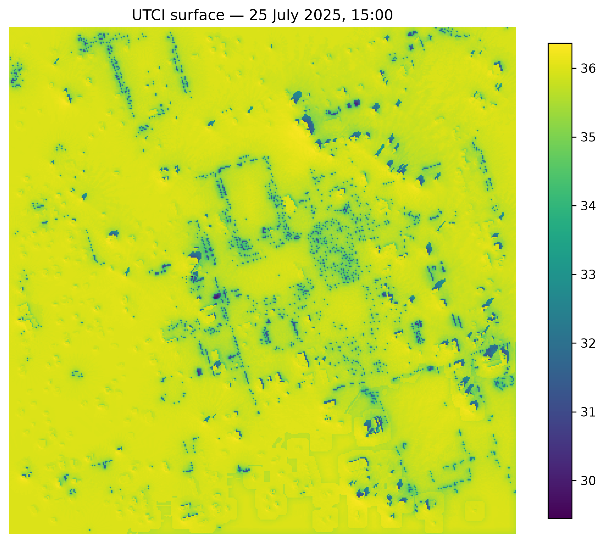{#fig-utci width=80%}

# 5. From thermal surface to thermal walking network

The key methodological step is transferring the thermal field onto the walking network.

UTCI is sampled along each valid walking edge. Each edge then receives a thermal attribute representing the thermal conditions experienced along that segment.

For edge $e$:

$$
UTCI_e
$$

denotes the mean sampled UTCI along the edge.

## Heat excess

Thermal penalty begins only above a selected threshold:

$$
H_e = \max(UTCI_e - \theta, 0)
$$

where:

- $UTCI_e$ = edge-level UTCI;
- $\theta$ = thermal threshold.

The reference specification uses:

$$
\theta = 32^\circ C
$$

## Thermal generalized cost

The normal walking cost is increased as a function of heat excess:

$$
c_e^{heat}
=
t_e
\left[
1+\lambda H_e
\right]
$$

where:

- $t_e$ = normal walking time;
- $H_e$ = heat excess;
- $\lambda$ = thermal-impedance sensitivity parameter;
- $c_e^{heat}$ = heat-conditioned generalized walking cost.

The reference specification uses:

$$
\lambda = 0.05
$$

Importantly, $\lambda$ is **not behaviorally calibrated** in the current proof-of-concept. It is treated as a sensitivity parameter.

## Edge-level thermal stress

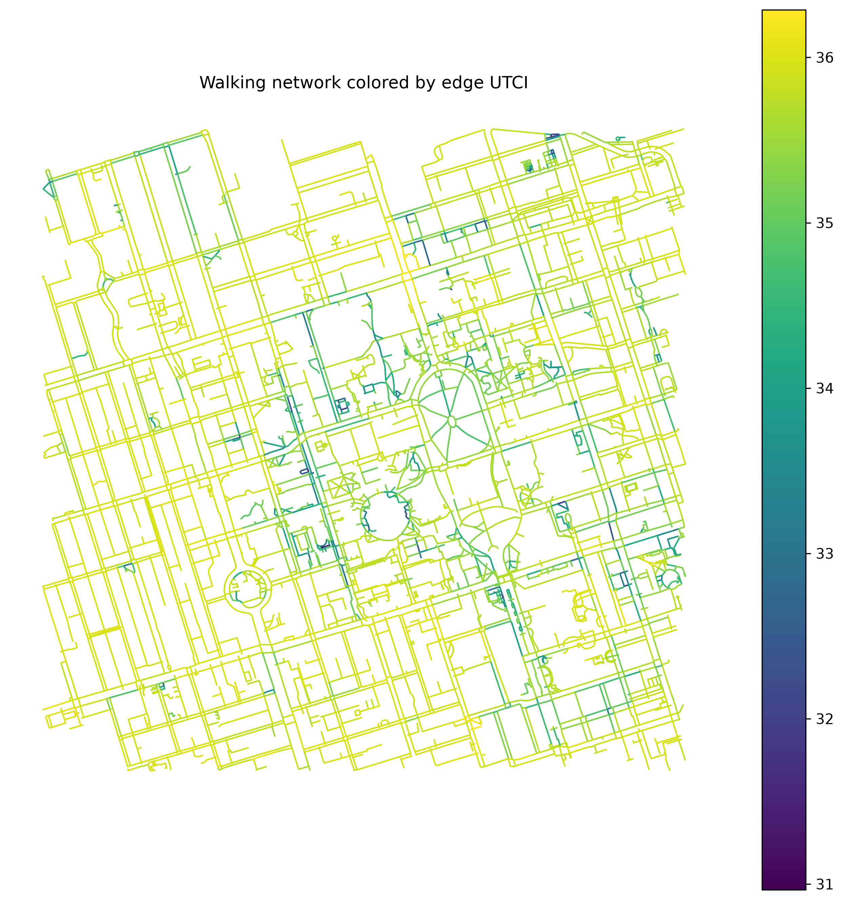{#fig-network-utci width=82%}

## Thermal-cost ratio

The thermal-cost ratio is:

$$
R_e =
\frac{c_e^{heat}}{t_e}
$$

Interpretation:

- $R_e = 1.00$ → no thermal penalty;
- $R_e = 1.10$ → generalized walking cost is 10% higher;
- $R_e = 1.25$ → generalized cost is 25% higher;
- $R_e = 1.40$ → generalized cost is 40% higher.

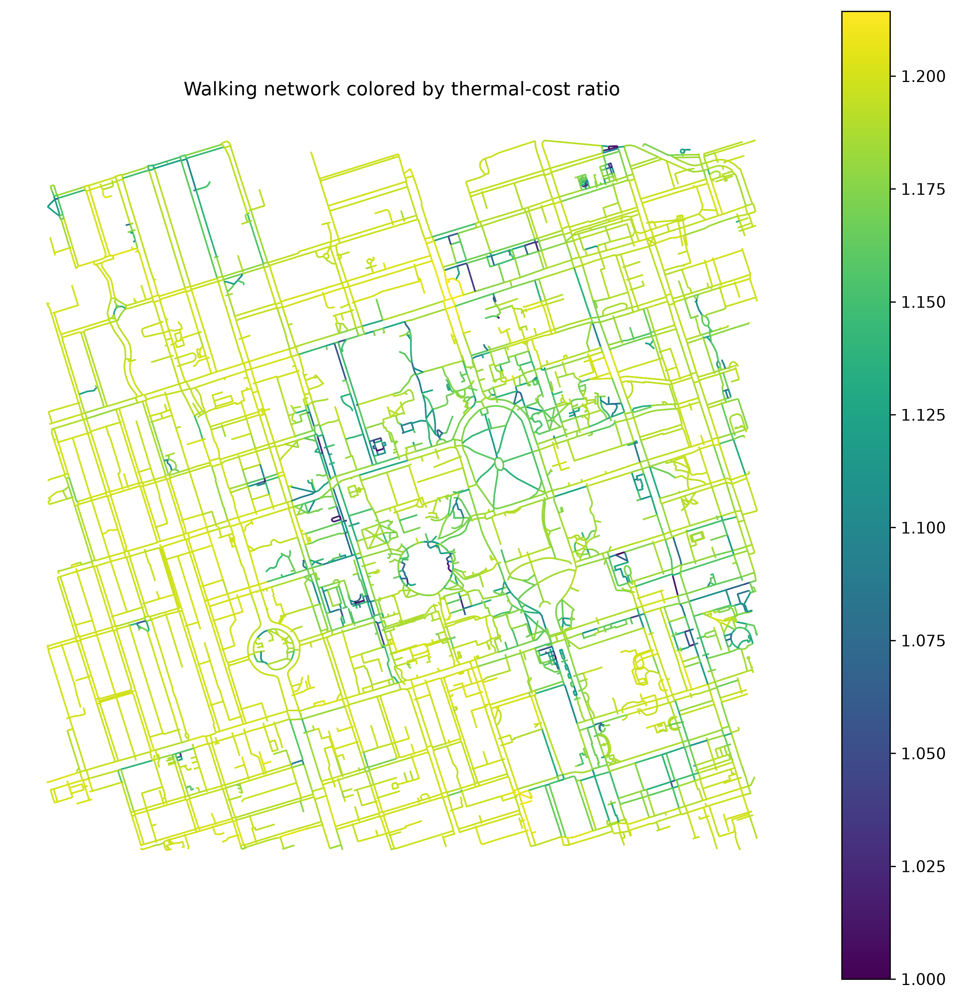{#fig-network-cost width=82%}

Across the 14 modeled scenarios, the mean thermal-cost ratio ranges from approximately **1.000 to 1.409** at $\lambda=0.05$.

# 6. Accessibility setup

Accessibility is measured from reproducible origin points to transit destinations.

The Toronto implementation uses:

- **50 accessibility origins**;
- transit stops as destinations;
- a **600-second generalized walking budget**;
- the same origin set and destination set across scenarios.

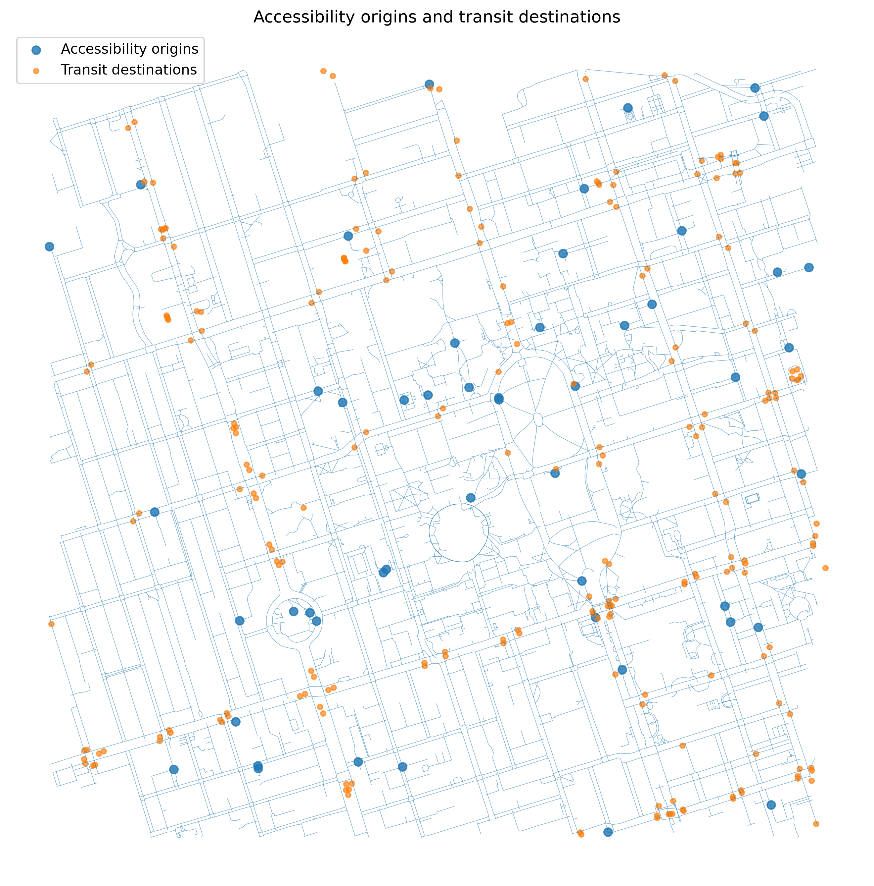{#fig-origins-transit width=82%}

## Normal accessibility

Normal accessibility is the number of transit destinations reachable within the 600-second budget using ordinary walking cost:

$$
A_i^{normal}
$$

## Heat-conditioned accessibility

Heat-conditioned accessibility uses thermal generalized cost:

$$
A_{is}^{heat}
$$

where $i$ is the origin and $s$ is the thermal scenario.

# 7. Accessibility loss

The central modeled outcome is **accessibility loss**:

$$
Loss_{is}
=
\frac{
A_i^{normal} - A_{is}^{heat}
}{
A_i^{normal}
}
\times 100
$$

Interpretation:

- **0%** = no reduction in reachable destinations;
- **10%** = one tenth of baseline reachable destinations are lost;
- **20%** = one fifth are lost;
- **45%** = almost half of baseline reachable destinations fall outside the generalized budget.

Accessibility loss is a **modeled outcome**. It is not an observed loss of trips.

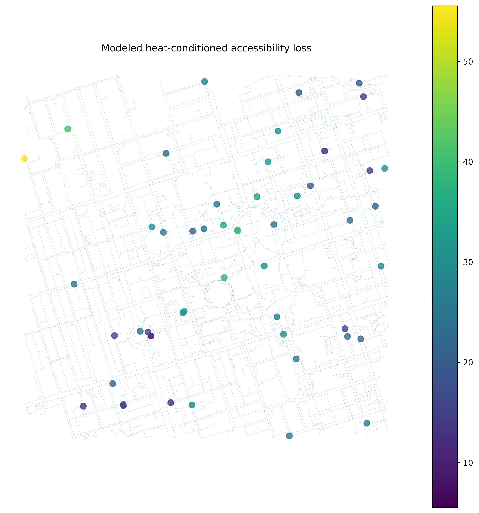{#fig-access-loss-map width=80%}

Across the modeled scenarios, mean accessibility loss ranges from **0.00% to 45.53%**.

# 8. Observed Bike Share response

Bike Share Toronto is used as an observed active-mobility response layer.

The station-day panel combines:

- station-level trip activity;
- date and weekday context;
- scenario-specific thermal conditions;
- modeled accessibility loss.

## Weekday-adjusted Bike Share response

The primary observed response compares station activity on a scenario date with the station's expected activity for the same weekday.

Conceptually:

$$
Response_{sd}
=
\log
\left(
\frac{
Trips_{sd}+0.5
}{
ExpectedTrips_{s,weekday}+0.5
}
\right)
$$

where:

- $s$ = station;
- $d$ = date.

Interpretation:

- positive → stronger-than-expected activity;
- zero → approximately expected activity;
- negative → weaker-than-expected activity.

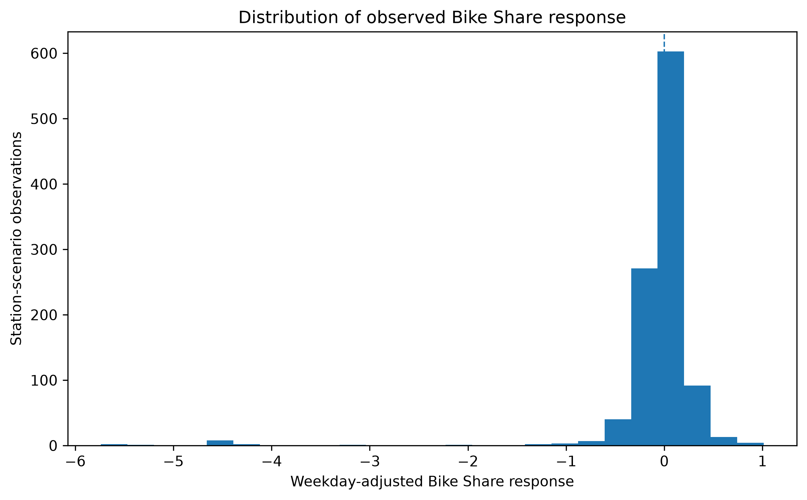{#fig-bike-response width=75%}

# 9. Linking modeled accessibility and observed mobility

The final station-scenario panel contains:

- thermal scenario;
- date;
- Bike Share station;
- modeled accessibility loss;
- observed weekday-adjusted Bike Share response.

The primary dataset contains:

- **14 thermal scenarios**;
- **75 Bike Share stations**;
- **1,050 station-scenario observations**.

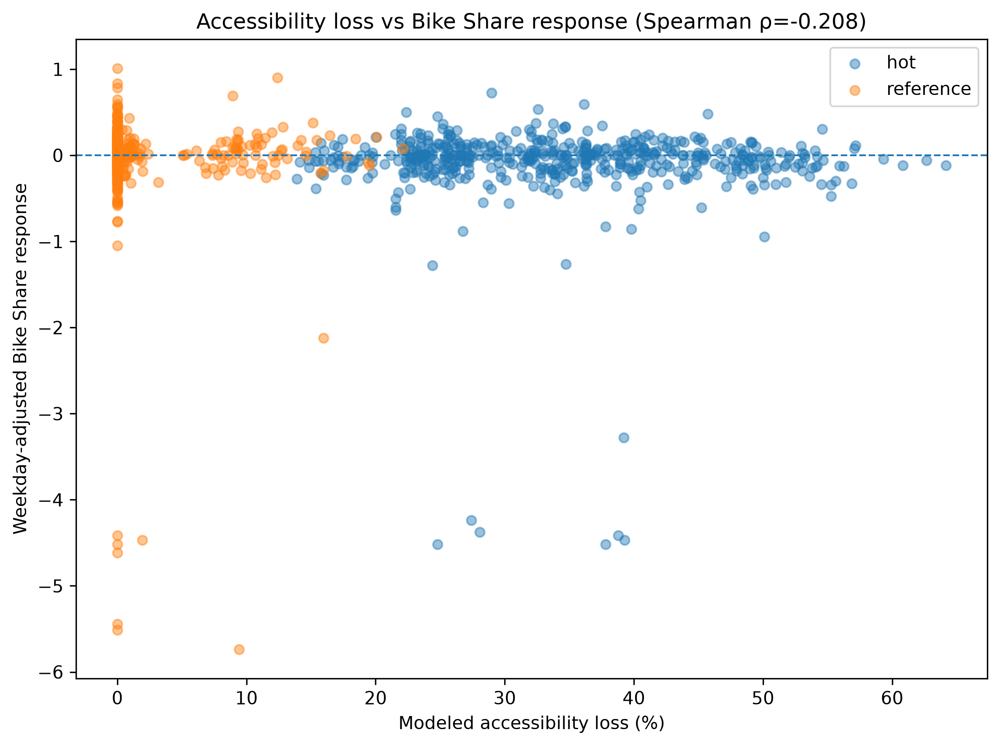{#fig-access-bike width=75%}

The primary association is:

$$
\rho = -0.2077
$$

This is a **modest negative association**:

> stations experiencing greater modeled heat-conditioned accessibility loss tend to show weaker same-day Bike Share activity.

The result is observational and should not be interpreted as causal.

# 10. Multi-scenario thermal impedance

The multi-scenario workflow is stronger than a one-day comparison because each date has its own:

1. meteorological conditions;
2. SOLWEIG thermal field;
3. edge-level UTCI;
4. thermal-network impedance;
5. accessibility loss;
6. same-day Bike Share response.

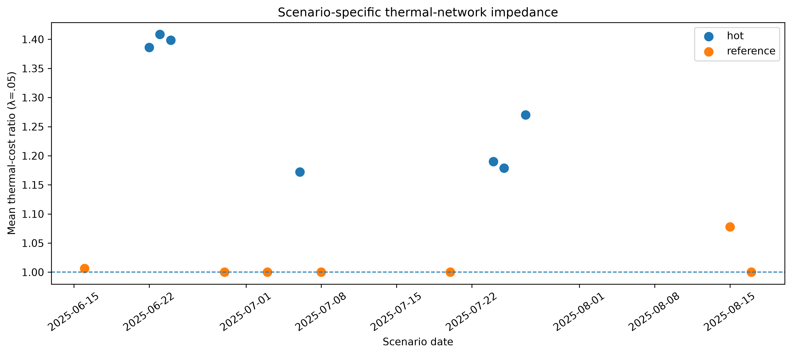{#fig-multiscenario-impedance width=88%}

Across scenarios, mean edge UTCI ranges from approximately:

**26.52 °C to 40.17 °C**

and the mean thermal-cost ratio ranges from:

**1.000 to 1.409**

# 11. Multi-scenario accessibility loss

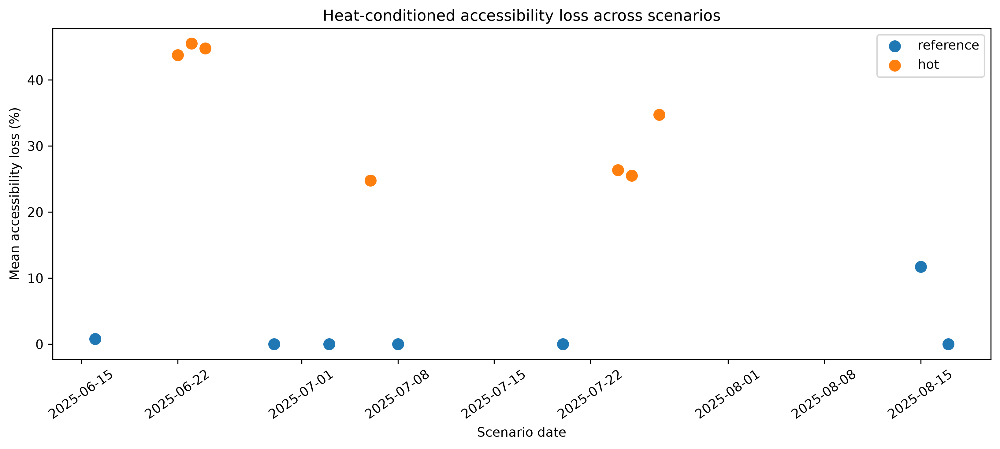{#fig-multiscenario-loss width=88%}

The scenario-average accessibility-loss range is:

**0.00% to 45.53%**

This confirms that thermal accessibility is highly scenario dependent.

# 12. Robustness: 75 versus 50 stations

The primary behavioral analysis uses **75 stations**.

A predefined **50-station core** is used as a spatial robustness test.

The full sample gives:

$$
\rho=-0.2077
$$

The core sample gives:

$$
\rho=-0.1974
$$

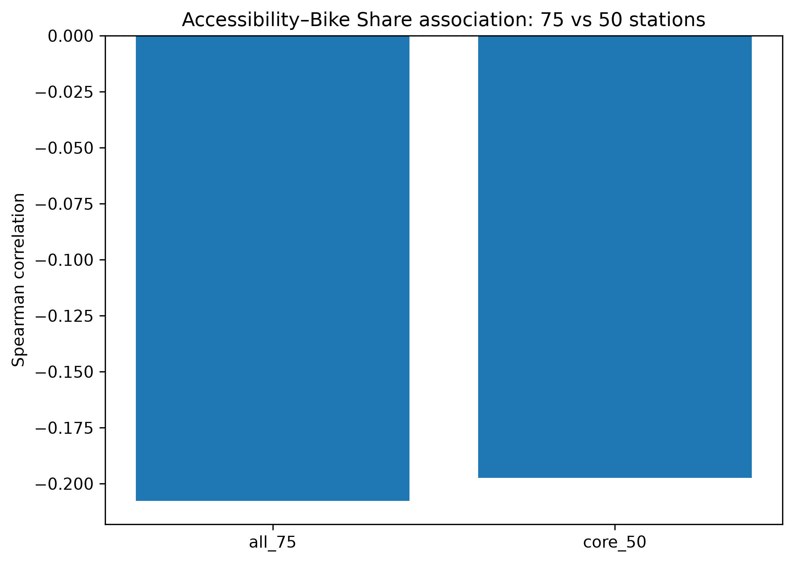{#fig-50-75 width=70%}

The small change in magnitude suggests that the result is not being driven only by the 25 more peripheral stations.

# 13. Sensitivity to $\lambda$ and thermal threshold

The thermal-cost model is tested across:

## UTCI thresholds

- 30 °C
- 32 °C
- 34 °C

## $\lambda$ values

- 0.01
- 0.025
- 0.05
- 0.075
- 0.10

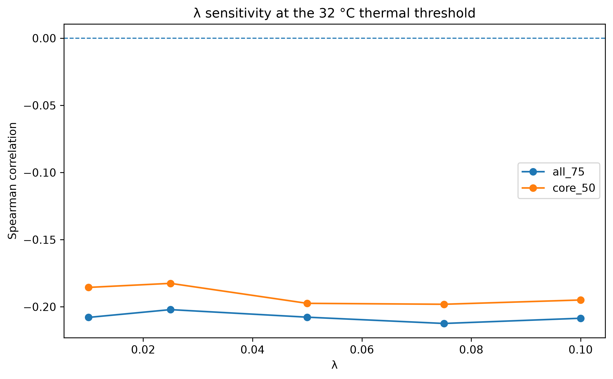{#fig-lambda width=75%}

Across all tested combinations:

- **100% are negative in the 75-station sample**;
- **100% are negative in the 50-station core**.

This consistency is more informative than focusing on a single parameter combination.

# 14. Workflow at a glance

The figure below summarizes the full Toronto proof-of-concept from spatial inputs through robustness analysis.

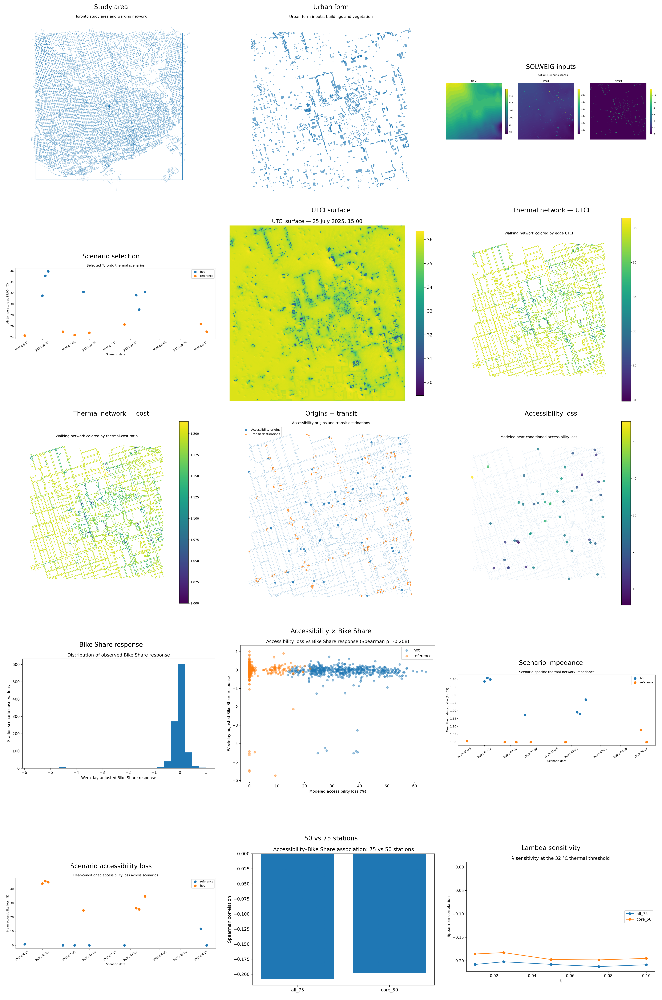{#fig-workflow-gallery width=100%}

# 15. Main results

| Metric | Toronto result |
|---|---:|
| Thermal scenarios | 14 |
| Accessibility origins | 50 |
| Bike Share stations | 75 |
| Linked station-scenario observations | 1,050 |
| Mean edge UTCI range | 26.52–40.17 °C |
| Mean thermal-cost ratio range at $\lambda=0.05$ | 1.000–1.409 |
| Mean accessibility-loss range | 0.00–45.53% |
| Primary 75-station Spearman $\rho$ | −0.2077 |
| Core 50-station Spearman $\rho$ | −0.1974 |
| Tested $\lambda \times$ threshold specifications with negative association | 100% |

# 16. Terminology

## Accessibility

The number of opportunities or destinations reachable within a specified travel-cost budget.

## Normal accessibility

Accessibility calculated using ordinary walking time.

## Heat-conditioned accessibility

Accessibility calculated using thermally adjusted generalized walking cost.

## Accessibility loss

The percentage reduction in reachable destinations when normal walking cost is replaced by heat-conditioned walking cost.

## UTCI

**Universal Thermal Climate Index**, used here as the primary outdoor thermal-stress indicator.

## Edge UTCI

Mean UTCI sampled along an individual network edge.

## Thermal threshold

The UTCI value above which the model begins applying an additional thermal penalty.

## Heat excess

The amount by which edge UTCI exceeds the thermal threshold.

## $\lambda$

The thermal-impedance sensitivity parameter controlling how strongly heat excess inflates generalized walking cost.

It is **not behaviorally calibrated** in the current proof-of-concept.

## Thermal generalized cost

Normal walking time after applying the thermal penalty.

It is a generalized cost and should not automatically be interpreted as literal perceived time.

## Thermal-cost ratio

The ratio between thermal generalized cost and normal walking cost.

## Thermal scenario

A specific modeled summer weather condition used to generate a thermal field and downstream network effects.

## Hot scenario

A selected high-temperature scenario representing stronger thermal stress.

## Reference scenario

A moderate comparison scenario paired with a hot scenario.

## Anchor scenario

The July 25, 2025 event retained to link the original one-event proof-of-concept to the multi-scenario workflow.

## Weekday-adjusted Bike Share response

Observed station-day Bike Share activity relative to that station's expected activity for the same weekday.

## Network saturation

A condition in which nearly all network edges exceed the selected thermal threshold.

## Robustness analysis

Testing whether the main association persists under alternative station samples, $\lambda$ values, and UTCI thresholds.

## Observational behavioral support

Evidence that modeled accessibility variation aligns systematically with observed mobility variation without implying causal validation.

# 17. What the Toronto proof-of-concept supports

The current analysis supports the following methodological conclusions.

### 1. Thermal conditions materially alter network impedance

The same physical walking network can have substantially different generalized costs under different thermal conditions.

### 2. Heat-conditioned accessibility is scenario dependent

Mean accessibility loss ranges from 0% to more than 45%.

### 3. Modeled accessibility loss has empirical behavioral relevance

Greater modeled accessibility loss is associated with weaker same-day Bike Share activity.

### 4. The direction is robust

The negative association persists across:

- the full 75-station sample;
- the predefined 50-station core;
- five $\lambda$ values;
- three UTCI thresholds.

### 5. The observed effect is modest rather than deterministic

The primary association is approximately:

$$
\rho \approx -0.21
$$

Thermal accessibility therefore explains only part of observed mobility variation.

# 18. What the analysis does not establish

The current proof-of-concept does **not** establish that:

- $\lambda=0.05$ is behaviorally calibrated;
- 32 °C is the uniquely correct threshold;
- heat causes the observed Bike Share changes;
- Bike Share directly validates pedestrian route choice;
- people deliberately choose cooler routes;
- one city and one summer provide universal behavioral parameters.

The current result is best described as:

> **a multi-scenario methodological proof-of-concept with observational behavioral support**

# 19. Remaining limitations

Important limitations include:

- Bike Share users are not equivalent to pedestrians;
- current station geometry may not perfectly represent historical station locations;
- station accessibility is interpolated from 50 modeled origins;
- meteorological controls remain simplified;
- only a limited set of detailed thermal scenarios is modeled;
- $\lambda$ is not behaviorally calibrated;
- the analysis currently represents one city and one summer.

These limitations motivate replication rather than invalidate the proof-of-concept.

# 20. Next research stage

The next scientific stage should focus on:

- direct accessibility calculation at station locations;
- historical station geometry;
- richer meteorological and calendar controls;
- repeated-measures or hierarchical inference;
- cross-city replication;
- behavioral calibration of $\lambda$;
- comparison with pedestrian or mobile-device mobility data.

The methodological objective is to move from:

**proof-of-concept**

to:

**generalizable heat-conditioned accessibility model**.

# Reproducibility

The workflow is organized as a sequence of reproducible notebooks covering:

1. environment setup;
2. study-area definition;
3. urban-form preparation;
4. SOLWEIG inputs;
5. thermal simulation;
6. thermal-network construction;
7. accessibility;
8. Bike Share response;
9. multi-scenario modelling;
10. robustness;
11. final synthesis and Quarto export.

The final public-facing assets are produced by the final synthesis notebook and stored under:

`data/toronto/processed/quarto_assets/`
