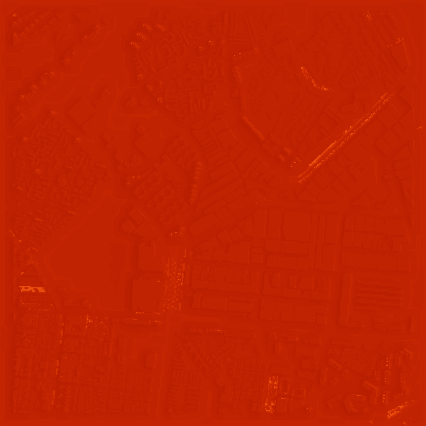
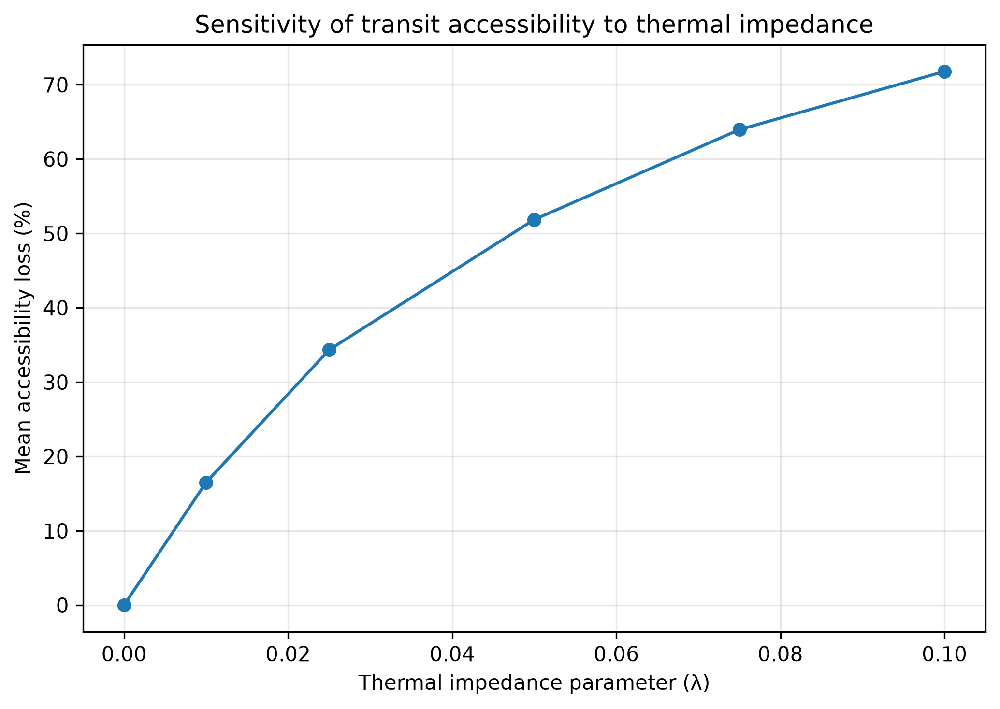

## Why this matters

Conventional accessibility measures usually represent travel impedance
through distance or travel time.

This proof of concept asks:

> How does estimated accessibility change when pedestrian thermal stress
> is incorporated directly into network impedance?

## Method

Urban morphology → thermal simulation → walking-network exposure
→ thermal impedance → accessibility

## Thermal environment

## Sensitivity analysis

